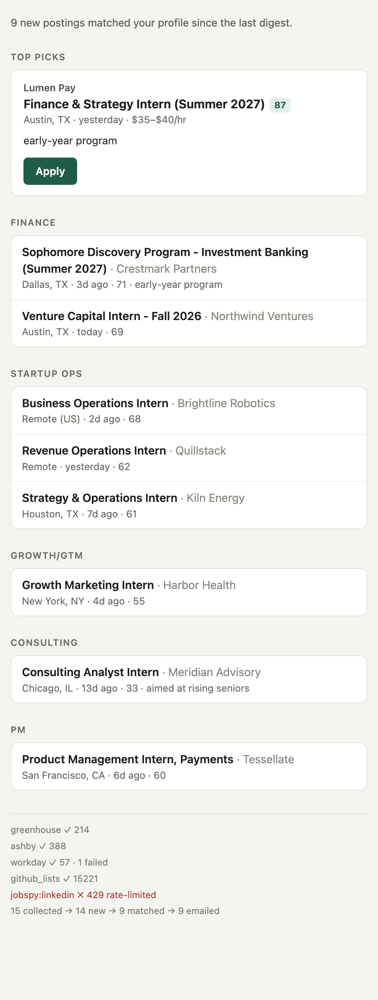

# Job Radar

A daily internship digest you fork and own. Job Radar checks ~260 company career sites, curated GitHub internship lists and (optionally) job boards and your Handshake/LinkedIn alert emails. It filters and ranks the results against your profile and emails you only the postings you haven't seen before.

It runs on GitHub Actions on a schedule. No server, no database, and free unless you turn on the optional Claude ranking step (a few cents a day).



**Built for business-side roles:** finance, startup ops, growth/GTM, consulting, product management. Role families, keywords, locations and seasons are all in one config file.

## Setup (about 15 minutes, no coding)

1. **Create your copy.** Click **Use this template** → **Create a new repository** → make it **Private**.
2. **Edit your profile.** In your new repo, open `config.example.yaml` and click the ✏️ pencil. Change the `profile`, `locations` and `role_families` sections, then commit. (You can rename it to `config.yaml`; Job Radar uses `config.yaml` if it exists and falls back to `config.example.yaml`.)
3. **Let it send email.**
   - Turn on [2-Step Verification](https://myaccount.google.com/signinoptions/two-step-verification) for your Gmail account, then create an [app password](https://myaccount.google.com/apppasswords) (16 characters).
   - In your repo: **Settings → Secrets and variables → Actions → New repository secret**. Add:
     - `SMTP_USER`: your Gmail address. The digest is sent from and to this address unless you set `profile.email_to`.
     - `SMTP_APP_PASSWORD`: the app password.
4. **(Optional) Smarter ranking.** Add an `ANTHROPIC_API_KEY` secret. Claude reads each match against your profile blurb and adds a category, a fit score and a one-line reason.
5. **(Optional) Handshake and LinkedIn alerts.** See [Alert emails](#handshake-and-linkedin-alert-emails-tier-2) below.
6. **First run.** Go to **Actions** → **Job Radar** → **Run workflow** → mode `backfill` → **Run**. In a few minutes you'll get a one-time email with the top 40 open roles. After that, a digest arrives each weekday morning with only new postings.

To change the schedule, edit the `cron` line in `.github/workflows/digest.yml` (it's in UTC; the default `0 11 * * 1-5` is ~6am Central).

## What you get

- **Top picks:** up to 5 postings above your score threshold, with an Apply button and why they fit.
- **Sections by category** (Finance, Startup Ops, Growth/GTM, Consulting, PM, Other), sorted by score.
- **Capped at 30.** Anything beyond that goes to a CSV linked from the email.
- **A footer** showing which sources ran, how many postings each returned and which failed, e.g. `lever ✓ 2578 · workday ✓ 1042 · 2 failed · jobspy:linkedin ✗ 429 rate-limited`.
- **Quiet days:** by default you get a one-line "nothing new" note on Mondays only (`email.send_when_empty`: `always | never | mondays`).
- **If every source fails,** you get a short failure email instead of silence.

## Where it looks

**Tier 1 — public job-board APIs (on by default)**

| Source | Covers |
|---|---|
| Greenhouse, Lever, Ashby, SmartRecruiters, Workable | Most VC-backed startups and fintechs |
| Workday | Banks, asset managers, consulting and accounting firms, large companies |
| Oracle Cloud HCM | JPMorgan Chase |
| Eightfold | Morgan Stanley |
| GitHub lists | `SimplifyJobs/Summer2027-Internships`, `vanshb03/Summer2027-Internships` (mostly tech, some PM/quant/finance) |

The seed watchlist (`data/seed_watchlist.yaml`) has ~260 companies. Each was checked live against its API when this repo was built. Add your own under `watchlist:` in the config. To find a company's details, run:

```sh
uv run jobradar add-company https://careers.somecompany.com
```

It detects the job board, checks it responds, and prints the line to paste.

**Known gaps.** Goldman Sachs, Bank of America, Evercore, Lazard, Jefferies, KKR, McKinsey, BCG, Bain, Deloitte, EY and KPMG run their own career sites that Job Radar can't read. To cover them, set up Handshake/LinkedIn alerts for those firms and turn on alert-email ingestion.

**Tier 2 — scraping (off by default, your call)**

> ⚠️ **Read this before enabling.** The `jobspy` source scrapes LinkedIn, Indeed, Google Jobs, Glassdoor and ZipRecruiter. **Those sites' terms prohibit automated access.** Scrapers break without warning, and LinkedIn blocks GitHub's datacenter IPs on most days unless you add a proxy (`PROXY_URLS` secret, comma-separated). Enabling it is your decision and your responsibility.

Turn it on with `sources.jobspy.enabled: true`. Indeed is the most reliable of the five.

### Handshake and LinkedIn alert emails (Tier 2)

Handshake has no public API and sits behind school SSO, so Job Radar reads the alert emails instead:

1. In Handshake and LinkedIn, save searches for the roles you want and turn on email alerts.
2. On your laptop, follow the steps at the top of `scripts/gmail_oauth_setup.py`. You'll create a Google Cloud OAuth client with **read-only** Gmail access, then run:
   ```sh
   uv sync --extra gmail
   uv run python scripts/gmail_oauth_setup.py
   ```
   It prints three secrets: `GMAIL_OAUTH_CLIENT_ID`, `GMAIL_OAUTH_CLIENT_SECRET` and `GMAIL_REFRESH_TOKEN`. Add them to your repo.
3. Set `sources.gmail_alerts.enabled: true`.

> **Important:** on Google's OAuth consent screen, click **Publish app** so the status is **In production**. Apps left in "Testing" get refresh tokens that expire after 7 days, and ingestion quietly stops. The email footer will say so if that happens.

The alert parsers were written against synthetic copies of the alert layouts. If one misses postings, save a real alert email as HTML into `tests/fixtures/emails/` and open an issue.

## How it decides what to send

```
collect → normalize → dedupe → filter → score → email → persist
```

- **Dedupe.** The same job found in two places (e.g. Greenhouse and LinkedIn) shows up once, linking to the company's own site. Matching uses the company (with aliases like "JPMorgan" = "J.P. Morgan Chase"), a fuzzy title match, the season, and overlapping locations. Different seasons at the same company ("Fall 2026" vs "Spring 2027") stay separate.
- **"New"** means not already sent. State lives in `seen.json` on an orphan `state` branch, so your main branch history stays clean. Entries are pruned 120 days after a posting was **last seen live**, not first seen, so long-running postings don't come back.
- **Nothing gets missed over weekends.** Time-windowed sources (job boards, alert emails) look back to their own last successful run plus a buffer, so weekends, skipped runs, delayed crons and a source that failed yesterday don't leave gaps.
- **Hard filters,** each logged with a drop reason in `state/runs/<date>.json` for tuning:
  1. **Posting type and season.** The posting must be an internship, off-cycle internship or part-time student role, in a season you listed.
  2. **Role family.** A keyword must match in the title, or at least two in the description when the title is generic.
  3. **Excluded title words** (whole words: "SWE" doesn't match "Answer", "intern" doesn't match "International").
  4. **Location.** Part-time roles must also be in `part_time_locations`.
  5. **Class year.** Postings that explicitly exclude your graduation year are dropped, as are MBA/PhD roles for undergrads. Postings are boosted for sophomore/early-insight programs and down-ranked when aimed at rising seniors. "Summer Analyst {year}" is treated as meant for the class graduating the following year.
- **Score (0–100):** title match × family weight, watchlist company, location preference, recency, season, pay signal and class-year fit. With Claude on, the final score is `0.4 × rule + 0.6 × fit`. Only the top 150 by rule score go to the model (cost cap). If the model's output is malformed, the rule score is used instead.

## Commands

```sh
uv sync --all-extras                 # install
uv run jobradar run --dry-run        # everything except sending/saving; writes preview.html
uv run jobradar run                  # full run (the first run automatically becomes a backfill)
uv run jobradar backfill             # seed state and send the top 40 currently open roles
uv run jobradar validate-config      # readable config errors (add --online to check GitHub lists exist)
uv run jobradar validate-watchlist   # hit every watchlist company once; report dead ones (-v for all)
uv run jobradar preview-email        # render the template from sample data
uv run jobradar add-company <url>    # detect a company's job board from a careers URL
uv run pytest                        # tests (recorded API fixtures, no network)
```

Locally, state goes to `./state/` (git-ignored). Secrets are read from environment variables with the same names as the GitHub secrets.

## Troubleshooting

- **No email arrived.** Check **Actions → Job Radar** for the run log. A red run means either the email failed (state isn't advanced, so nothing is lost) or every source failed.
- **"Gmail rejected the login".** Use an app password, not your normal password.
- **Too much noise.** Look at `drop_counts` in `state/runs/<date>.json`, then tighten `role_families` keywords or add `exclude_title_keywords`.
- **A company disappeared.** Run `validate-watchlist`. Companies switch job boards; re-run `add-company` with their careers URL.
- **GitHub lists 404 in a new cycle.** The repos get renamed (Summer2027 → Summer2028). Update `github_lists`.
- **Scheduled runs stopped (public repos only).** GitHub disables scheduled workflows in public repos after 60 days without activity. The daily state commit normally counts as activity; if runs stop, re-enable the workflow in the Actions tab. Private repos aren't affected. They do use Actions minutes, but a daily run is ~5 minutes, far under the free 2,000/month.

## Using Resend instead of Gmail

Set `email.provider: resend` and `email.from_address` (an address on a domain verified in Resend), and add a `RESEND_API_KEY` secret. Without a verified domain, Resend only delivers to the account owner's address.

## License

MIT
